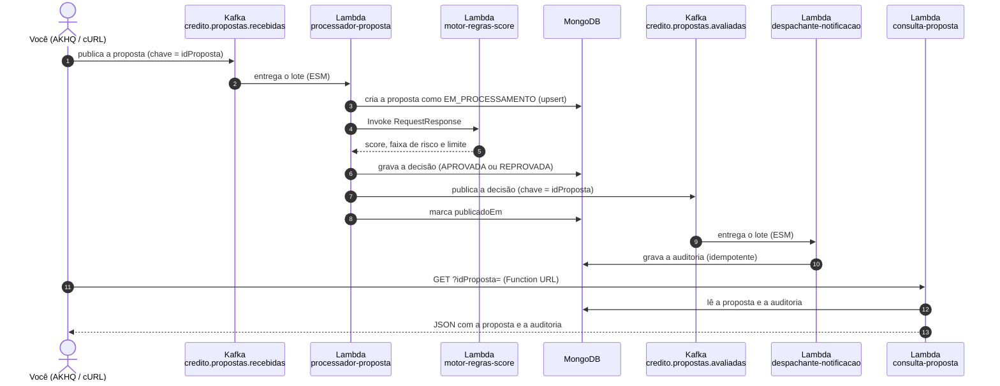

# ⚡ Motor de Análise de Crédito — Serverless Event-Driven com AWS Lambda (.NET)

[](https://dotnet.microsoft.com/)
[](https://docs.aws.amazon.com/lambda/latest/dg/lambda-csharp.html)
[-red)](https://kafka.apache.org/)
[](https://www.mongodb.com/)
[](https://localstack.cloud/)
[](https://xunit.net/)
[](./_context)

---

## 1. Resumo

Arquitetura de referência **serverless orientada a eventos** (EDA) executada **localmente**, sem custo de nuvem. O projeto simula uma esteira transacional de análise de crédito composta por quatro funções **AWS Lambda em C# (.NET 10)**, emuladas no **LocalStack**, que consomem e produzem eventos no **Apache Kafka** via **Event Source Mapping (ESM)**, persistem no **MongoDB** e são cobertas por testes automatizados com **xUnit**.

> **Chegou agora?** A [seção 14](#14-como-estudar-o-projeto) traz um roteiro de leitura do repositório, na ordem que faz mais sentido para entender o projeto.

---

## 2. Problema e Solução

Em esteiras de crédito com alta concorrência, quatro problemas aparecem com frequência:

1. **Motor de risco acoplado a I/O.** A regra de decisão é determinística, mas costuma ficar misturada com acesso a banco e mensageria, o que dificulta testar e escalar.
2. **Connection storm em serverless.** Quando o tráfego do Kafka cresce, dezenas de instâncias concorrentes de Lambda abrindo conexões sem controle derrubam o MongoDB.
3. **Entrega *at-least-once* do Kafka.** Falhas transitórias reentregam o mesmo evento. Sem idempotência, a mesma proposta é recalculada e auditada em duplicidade.
4. **Escrita dupla (MongoDB + Kafka).** Se a Lambda grava a decisão no banco e falha antes de publicar no Kafka, a reentrega não pode simplesmente "pular" a proposta, senão o evento se perde.

### Solução proposta

- **Domínio puro isolado:** o cálculo de score roda em uma Lambda própria (`motor-regras-score`), sem dependência de rede ou banco, invocada de forma síncrona (`RequestResponse`) pela Lambda orquestradora.
- **Gerenciamento de conexões:** `MongoClient`, `IProducer` (Confluent.Kafka) e `AmazonLambdaClient` são instâncias estáticas criadas fora do handler, reaproveitadas entre *warm starts*, com pool enxuto (`MaxConnectionPoolSize = 5`).
- **Idempotência:** índice único por `idProposta` + upsert com `$setOnInsert`, máquina de estados explícita da proposta e marcação de publicação (`publicadoEm`) para que uma reentrega republique o evento quando a decisão já foi gravada mas não publicada.
- **Observabilidade e consulta:** interface web para inspecionar os tópicos do Kafka e uma Lambda HTTP (`consulta-proposta`) para auditar o MongoDB direto pelo navegador.

---

## 3. Arquitetura



**Ciclo de vida da proposta:** `EM_PROCESSAMENTO → APROVADA | REPROVADA` (+ `publicadoEm` quando o evento de decisão foi confirmado no Kafka).

---

## 4. Componentes

| Lambda | Gatilho | Evento de entrada (.NET) | Responsabilidade |
| --- | --- | --- | --- |
| `processador-proposta` | ESM em `credito.propostas.recebidas` | `KafkaEvent` | Decodifica o lote, registra `EM_PROCESSAMENTO` com trava de idempotência, invoca o motor via AWS SDK, grava a decisão e publica em `credito.propostas.avaliadas`. |
| `motor-regras-score` | Invocação direta (`RequestResponse`) | DTO próprio (`AvaliacaoScoreRequest`) | Avalia comprometimento de renda vs. valor solicitado, calcula o score, enquadra a faixa de risco (`BAIXO`, `MEDIO`, `ALTO`) e define o limite. Sem I/O. |
| `despachante-notificacao` | ESM em `credito.propostas.avaliadas` | `KafkaEvent` | Persiste uma trilha imutável e idempotente em `auditoria_propostas`. |
| `consulta-proposta` | Lambda Function URL (HTTP GET) | `APIGatewayHttpApiV2ProxyRequest` | Recebe `idProposta` via query string, agrega proposta + auditoria e devolve JSON (404 se não existir). |

As regras de negócio, contratos e critérios de aceite de cada componente estão nas especificações em [`_context/`](./_context).

---

## 5. Decisões Técnicas

Resumo das decisões. Os detalhes e trade-offs ficam registrados em [`docs/adr/`](./docs/adr).

- **Runtime gerenciado `dotnet10`** (LTS). Native AOT fica fora do escopo inicial e será avaliado depois, medindo cold start.
- **Invocação síncrona Lambda → Lambda** é uma escolha deliberada de estudo para isolar o domínio. Em produção isso tem custo (a orquestradora fica parada aguardando) e acoplamento; a alternativa (motor como biblioteca dentro da mesma Lambda) está documentada na ADR.
- **Chave da mensagem Kafka = `idProposta`**, garantindo ordem por proposta dentro da partição.
- **Producer Kafka com `Flush`** antes do retorno do handler, porque o ambiente da Lambda é congelado entre invocações.
- **Dados sensíveis:** o CPF nunca aparece em logs (mascarado), em linha com a LGPD.

---

## 6. Stack Tecnológica

| Tecnologia | Função no ecossistema |
| --- | --- |
| **.NET 10 / C#** | Linguagem e runtime das Lambdas (`dotnet10`) |
| **Amazon.Lambda.\*** | `Core`, `Serialization.SystemTextJson`, `KafkaEvents`, `APIGatewayEvents` e `Amazon.Lambda.Tools` para empacotamento |
| **AWSSDK.Lambda** | Invocação síncrona do motor de score |
| **Confluent.Kafka** | Producer para publicar a decisão de crédito |
| **MongoDB.Driver** | Persistência de propostas e auditoria |
| **LocalStack** | Emulação local de Lambda, IAM, ESM e Function URL |
| **Apache Kafka (KRaft)** | Broker de eventos, sem ZooKeeper |
| **AKHQ** | Interface web para tópicos, mensagens e partições |
| **xUnit + NSubstitute + Shouldly** | Testes unitários e mocks |
| **Testcontainers for .NET** | Testes de integração com MongoDB e Kafka reais |
| **coverlet** | Relatório de cobertura |

---

## 7. Estrutura do Repositório

```text
.
├── .github/
│   ├── copilot-instructions.md        # regras globais para o Copilot
│   ├── instructions/                  # instruções por tipo de arquivo
│   └── prompts/                       # prompts reutilizáveis (ex.: implementar uma spec)
├── _context/                          # especificações (fonte da verdade do desenvolvimento)
├── docs/adr/                          # registros de decisão de arquitetura
├── infra/localstack/init/ready.d/     # script que cria Lambdas, ESMs e Function URL
├── scripts/                           # empacotamento, publicação de eventos de teste
├── src/
│   ├── MotorCredito.Dominio/                    # contratos, entidades e regras puras
│   ├── MotorCredito.Infraestrutura/             # MongoDB, Kafka, cliente Lambda
│   ├── MotorCredito.Lambda.MotorRegrasScore/    # depende só do Dominio
│   ├── MotorCredito.Lambda.ProcessadorProposta/
│   ├── MotorCredito.Lambda.DespachanteNotificacao/
│   └── MotorCredito.Lambda.ConsultaProposta/
├── tests/                             # um projeto de teste por Lambda + integração
├── docker-compose.yml
├── .env.example
└── MotorAnaliseCredito.slnx
```

---

## 8. Pré-requisitos

- [.NET 10 SDK](https://dotnet.microsoft.com/download)
- Amazon.Lambda.Tools: `dotnet tool install -g Amazon.Lambda.Tools`
- [Docker](https://www.docker.com/) e Docker Compose
- **Conta no LocalStack + auth token.** Desde março de 2026 a imagem do LocalStack exige `LOCALSTACK_AUTH_TOKEN`. O plano gratuito (Hobby) é restrito a uso não comercial; verifique se o seu uso se enquadra nele.
- Opcional: [`awslocal`](https://github.com/localstack/awscli-local) para inspecionar os recursos

---

## 9. Como Executar Localmente

### Passo 1: Configurar variáveis

```bash
cp .env.example .env
# edite o .env e preencha LOCALSTACK_AUTH_TOKEN
```

### Passo 2: Restaurar, testar e empacotar as Lambdas

```bash
dotnet restore
dotnet test
./scripts/empacotar-lambdas.sh
```

*Gera um pacote por Lambda em `dist/*.zip` (via `dotnet lambda package`), que o LocalStack carrega na inicialização.*

### Passo 3: Subir o ambiente

```bash
docker compose up -d
```

*Sobe Kafka, MongoDB, AKHQ (porta `8080`) e LocalStack (porta `4566`). O script em `infra/localstack/init/ready.d/` cria os tópicos, as 4 Lambdas, os 2 Event Source Mappings e a Function URL.*

### Passo 4: Conferir os recursos

```bash
awslocal lambda list-functions --query "Functions[].FunctionName"
awslocal lambda list-event-source-mappings --query "EventSourceMappings[].[FunctionArn,State]"
```

---

## 10. Testes Automatizados

| Camada | Escopo | Comando |
| --- | --- | --- |
| **Arquitetura** | Regras de referência entre projetos e pacotes proibidos | `dotnet test --filter "Category=Arquitetura"` |
| **Unitários** | Regras de cada Lambda isoladas, com SDK da AWS, Kafka e MongoDB mockados | `dotnet test --filter "Category!=Integracao"` |
| **Integração** | Repositórios e idempotência contra MongoDB/Kafka reais via Testcontainers | `dotnet test --filter "Category=Integracao"` |
| **Cobertura** | Relatório consolidado | `dotnet test --collect:"XPlat Code Coverage"` |

Cenários obrigatórios por Lambda (detalhados nas specs):

- **Motor de score:** tabela de casos de score, faixa de risco e limite, incluindo valores de borda e entradas inválidas.
- **Processador:** lote com várias mensagens, mensagem duplicada, mensagem corrompida, falha na invocação do motor e falha na publicação após gravar a decisão.
- **Despachante:** gravação da auditoria, reentrega do mesmo evento sem duplicar e lote vazio ou corrompido.
- **Consulta:** proposta encontrada com auditoria, `idProposta` ausente (400) e proposta inexistente (404).

---

## 11. Teste Manual Ponta a Ponta

### Cenário 1: Disparar uma proposta pela interface do Kafka

1. Abra **`http://localhost:8080`** (AKHQ).
2. Em **Topics**, selecione **`credito.propostas.recebidas`**.
3. Clique em **Produce to topic**, use `PROP-2026-001` como chave e envie:

```json
{
  "idProposta": "PROP-2026-001",
  "documentoCpf": "12345678901",
  "valorSolicitado": 25000,
  "rendaMensal": 8000
}
```

4. Abra o tópico **`credito.propostas.avaliadas`** e confira a decisão com score e limite.

### Cenário 2: Consultar o resultado pela Function URL

```bash
URL=$(awslocal lambda get-function-url-config \
  --function-name consulta-proposta --query FunctionUrl --output text)

curl "${URL}?idProposta=PROP-2026-001"
```

*No LocalStack a URL tem o formato `http://<url-id>.lambda-url.us-east-1.localhost.localstack.cloud:4566/`.*

**Resposta esperada:**

```json
{
  "proposta": {
    "idProposta": "PROP-2026-001",
    "documentoCpf": "***.456.789-**",
    "valorSolicitado": 25000,
    "rendaMensal": 8000,
    "pontuacaoScore": 750,
    "faixaRisco": "BAIXO",
    "limiteAprovado": 25000,
    "status": "APROVADA",
    "criadoEm": "2026-11-09T10:00:00.000Z",
    "avaliadoEm": "2026-11-09T10:00:01.000Z",
    "publicadoEm": "2026-11-09T10:00:01.200Z"
  },
  "auditoria": [
    {
      "evento": "DECISAO_REGISTRADA",
      "registradoEm": "2026-11-09T10:00:02.000Z"
    }
  ]
}
```

### Cenário 3: Validar a idempotência

Reenvie **exatamente a mesma mensagem** do Cenário 1 e consulte de novo: a proposta não deve ser recalculada e a auditoria deve continuar com um único registro.

---

## 12. Desenvolvimento Orientado a Especificação

Cada funcionalidade nasce de uma spec em [`_context/`](./_context), implementada na ordem numérica. O fluxo de trabalho:

1. Escolher a próxima spec e abrir uma branch.
2. Pedir ao Copilot para implementá-la com o prompt de `.github/prompts/`, respeitando `.github/copilot-instructions.md`.
3. Revisar o PR contra os **critérios de aceite** da spec. Se o código divergir da spec, corrige-se a spec primeiro e depois o código.

---

## 13. Fora do Escopo (por enquanto)

- Deploy em uma conta AWS real (SAM ou CDK)
- Native AOT e comparação de cold start
- Schema Registry para os eventos
- Autenticação na Function URL
- Pipeline de CI/CD: o projeto foi feito para rodar localmente; basta clonar e seguir a seção 9

---

## 14. Como Estudar o Projeto

Este repositório foi feito para ser lido, não só executado. As decisões de arquitetura estão registradas em ADRs, as regras estão nas specs, e o código só é escrito depois que a spec que o descreve é aprovada. Por isso, a ordem de leitura importa: quem começa pelo código vê **o que** foi feito, mas não entende **por quê**.

O roteiro abaixo vai do geral para o específico. 

| Etapa | O que ler |
| --- | --- |
| 1 | Este README |
| 2 | As decisões de arquitetura (`docs/adr/`) |
| 3 | As regras do projeto (`_context/`) |
| 4 | As specs já implementadas (`_context/specs/`) |
| 5 | Como o Copilot é guiado (`.github/`) |
| 6 | O código e os testes (`src/` e `tests/`) |
| 7 | Rodar e quebrar de propósito |


### Etapa 1 — O mapa: este README

**Por que começar aqui:** o README mostra o problema, a arquitetura e o papel de cada Lambda, sem entrar em detalhe. É o mapa que você vai usar para se localizar nas outras etapas.

**Leia com atenção:** as seções 2 (problema e solução), 3 (o diagrama de sequência) e 4 (os componentes). As seções 9 a 11 descrevem o projeto completo. Para saber o que já está implementado, veja a tabela de specs em [`_context/memory.md`](./_context/memory.md).

### Etapa 2 — O porquê: as ADRs

**Por que agora:** cada ADR (*Architecture Decision Record*) registra uma decisão, as alternativas descartadas e o preço que se paga por ela. É ali que está a resposta para "por que não fizeram de outro jeito?". Quem pula esta etapa costuma achar estranhas escolhas que foram feitas de propósito.

**Ordem sugerida em [`docs/adr/`](./docs/adr):**

1. **0002 — runtime `dotnet10`:** a mais simples, boa para conhecer o formato de uma ADR.
2. **0001 — invocação síncrona entre Lambdas:** por que o motor de score é uma Lambda separada, e por que isso seria um antipadrão em produção.
3. **0004 — idempotência e publicação no Kafka:** **a mais importante do projeto.** Leia com calma a tabela de reprocessamento da seção 3.
4. **0003 — LocalStack:** os riscos de emular a AWS localmente e o plano B.

### Etapa 3 — As regras: spec 00, memória e changelog

**Por que agora:** a [spec 00](./_context/specs/00_especificacao-constituicao-e-convencoes.md) é a constituição do projeto. Vale para todo código e toda spec, e prevalece sobre qualquer outra instrução. O [`memory.md`](./_context/memory.md) mostra o estado atual, e o [`changelog.md`](./_context/changelog.md) mostra como se chegou até ele.

**Leia com atenção** na spec 00: as seções 1 (as regras), 2 (a definição de pronto), 3 (quem pode referenciar quem entre os projetos) e 4.7 (o modelo que toda spec segue).

### Etapa 4 — O contrato de cada entrega: as specs implementadas

**Por que agora:** cada spec descreve uma entrega completa: as regras de negócio (RN), os critérios de aceite (CA), os casos de borda (EC) e o teste que cobre cada um. Lendo a spec antes do código, você sabe o que o código deveria fazer e consegue julgar se ele faz.

**Como ler:** leia só as specs com status `Implementada` (veja a tabela do `memory.md`), na ordem numérica. As que estão como `Rascunho` são o futuro. Em cada spec, foque nas seções 1 (RN), 4 (implementação detalhada) e 8 (edge cases). A seção 5 (testes) fica para a etapa 6.

### Etapa 5 — A automação: como o Copilot é guiado

**Por que agora:** o código é escrito pelo GitHub Copilot, guiado pelas specs. Os arquivos de [`.github/`](./.github) traduzem a spec 00 em instruções para ele. Depois de ler as etapas 3 e 4, você vai reconhecer cada regra, e vai entender quais limites foram dados à IA.

**Ordem sugerida:**

1. `copilot-instructions.md`: as regras globais.
2. `instructions/csharp-lambda.instructions.md`: as regras para o código de `src/`.
3. `instructions/testes.instructions.md`: as regras para os testes.
4. `prompts/implementar-especificacao.prompt.md`: o passo a passo que o Copilot segue para implementar uma spec.

### Etapa 6 — A prova: o código e os testes

**Por que só agora:** o código é a confirmação do que as specs prometeram. Leia cada arquivo **junto com o seu teste**: o teste mostra, com exemplos concretos, o comportamento esperado e os casos que o código precisa recusar.

**Ordem sugerida no domínio** (`src/MotorCredito.Dominio/` com `tests/MotorCredito.Dominio.Tests/`):

| Ordem | Código | Teste |
| --- | --- | --- |
| 1 | `Propostas/` e `Auditoria/` (enums e entidades) | `Modelo/TiposDoDominioTests.cs` |
| 2 | `Eventos/` e `Score/` (os contratos) | `Modelo/ProtecaoCpfTests.cs` |
| 3 | `Serializacao/MotorCreditoJsonContext.cs` | `Serializacao/ContratosJsonTests.cs` |
| 4 | `Serializacao/EnumEstritoConverter.cs` | `Serializacao/EnumsJsonTests.cs` |
| 5 | `Serializacao/DataUtcConverter.cs` | `Serializacao/DatasJsonTests.cs` |
| 6 | `Contratos/RegrasDeCampo.cs` e os validadores | `Contratos/Validador*Tests.cs` |
| 7 | `Contratos/LeitorDeContratos.cs` | `Contratos/LeitorDeContratosTests.cs` |

Depois do domínio, veja [`tests/MotorCredito.Arquitetura.Tests/`](./tests/MotorCredito.Arquitetura.Tests): são as regras da spec 00 transformadas em testes automáticos. Por fim, leia as Lambdas em `src/MotorCredito.Lambda.*` e os scripts de [`scripts/`](./scripts).
